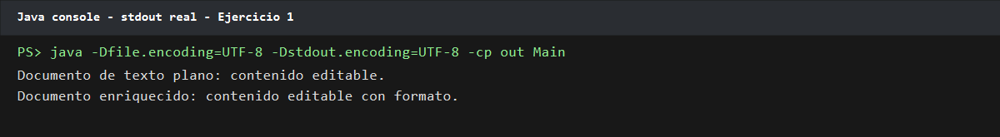

# Ejercicio 1 - Generador básico de documentos

Factory Method separa los documentos (`Document`) de sus creadores. Cada
creador concreta elige el documento de texto plano o enriquecido; el cliente
solo solicita abrirlo a través del creador.

```powershell
javac -d out src\Main.java
java -cp out Main
```


