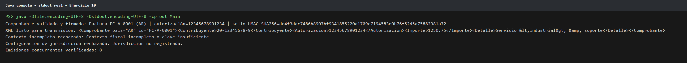

# Ejercicio 10 - Comprobantes fiscales empresariales

Las factorías por jurisdicción validan la solicitud y su contexto antes de
emitir XML. El ejemplo genera un sello HMAC-SHA-256 con clave proporcionada
por el llamador (no se incluye una clave real), escapa el contenido XML,
rechaza jurisdicciones/datos incompletos y comparte factorías inmutables de
forma segura entre hilos. Es una demostración educativa: no implementa
validación fiscal oficial ni reemplaza certificados, servicios tributarios o
firmas digitales reguladas.

```powershell
javac -d out src\Main.java
java -cp out Main
```


