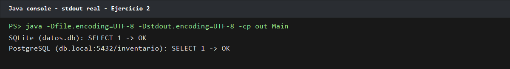

# Ejercicio 2 - Conexiones a motores de base de datos

La selección del creador está aislada en `ConnectionCreatorSelector`; el
cliente de negocio trabaja con la abstracción `ConnectionCreator`. Los
conectores simulan la consulta de prueba sin requerir drivers ni servidores.

```powershell
javac -d out src\Main.java
java -cp out Main
```


