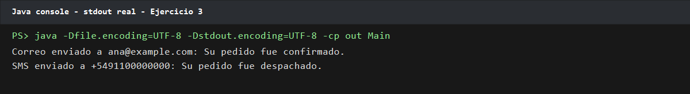

# Ejercicio 3 - Notificaciones multiplataforma

Los canales de correo y SMS implementan `NotificationChannel`; sus creadores
configuran cada destino y el consumidor envía usando únicamente el contrato
común. Los envíos son simulados.

```powershell
javac -d out src\Main.java
java -cp out Main
```


