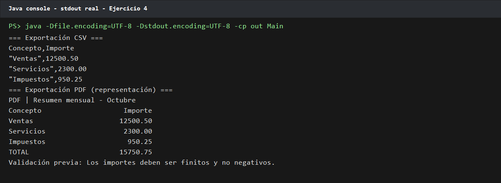

# Ejercicio 4 - Exportadores de reportes financieros

El método plantilla `ReportCreator.generate` valida todos los datos antes de
crear el exportador. CSV y PDF son representaciones simuladas implementadas
sin bibliotecas externas; cada producto encapsula sus reglas de formato.

```powershell
javac -d out src\Main.java
java -cp out Main
```


