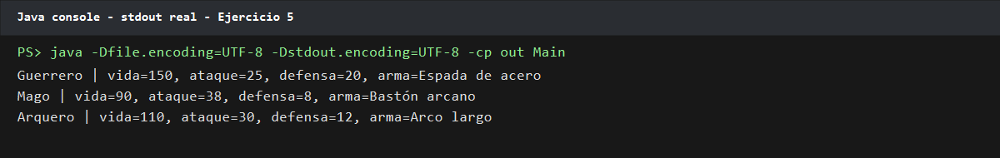

# Ejercicio 5 - Personajes para un videojuego de rol

`CharacterWorkshop` ofrece la creación por tipo solicitado; cada creador
concreto define vida, ataque, defensa y arma inicial. La selección de atributos
no queda en condicionales del cliente.

```powershell
javac -d out src\Main.java
java -cp out Main
```


