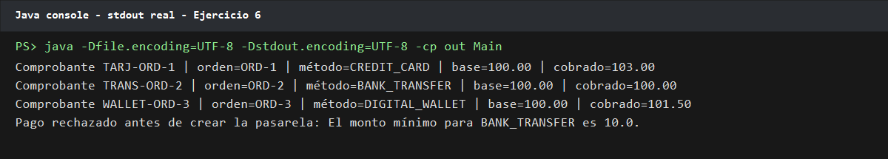

# Ejercicio 6 - Factoría de métodos de pago

`PaymentService` selecciona el creador a partir de la orden. Cada factoría
valida el mínimo antes de construir la pasarela; los productos aplican sus
reglas de comisión y devuelven un comprobante. No se conecta a servicios reales.

```powershell
javac -d out src\Main.java
java -cp out Main
```


