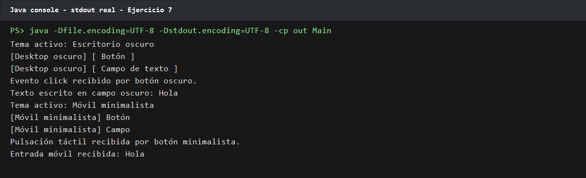

# Ejercicio 7 - Interfaz gráfica adaptativa

Cada `UiFactory` crea una familia homogénea de botón y campo de texto. `Screen`
recibe una sola fábrica y utiliza los contratos de renderizado e interacción,
evitando combinar temas de escritorio y móvil.

```powershell
javac -d out src\Main.java
java -cp out Main
```


