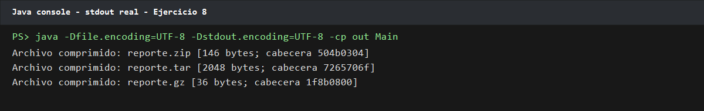

# Ejercicio 8 - Refactorización a Factory Method

La selección de compresión vive en `CompressionRegistry`; `ArchiveService`
solo recibe un creador por abstracción, valida la solicitud y delega. ZIP y GZ
se generan con la biblioteca estándar de Java; TAR usa una cabecera USTAR
básica. Los archivos se crean en memoria y se informa su tamaño y firma, sin
dependencias ni bloques de selección en el servicio de negocio.

```powershell
javac -d out src\Main.java
java -cp out Main
```


