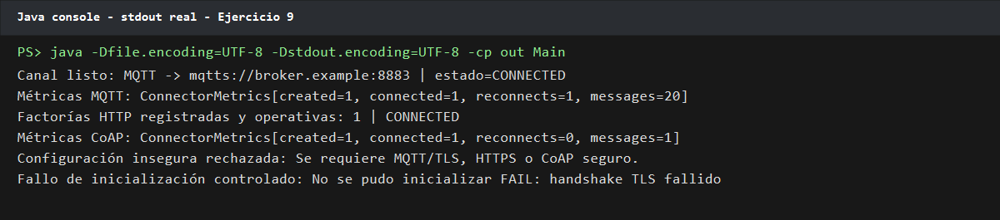

# Ejercicio 9 - Conectores IoT para telemetría

El registro concurrente permite añadir factorías en ejecución. La configuración
inmutable exige credenciales y protocolos TLS; la creación captura y traduce
fallos de validación/inicialización. Los conectores simulan el ciclo de vida,
reconexión y métricas con contadores atómicos; no establecen conexiones reales.
El ejemplo también publica concurrentemente y añade HTTP después de crear el
registro inicial.

```powershell
javac -d out src\Main.java
java -cp out Main
```


