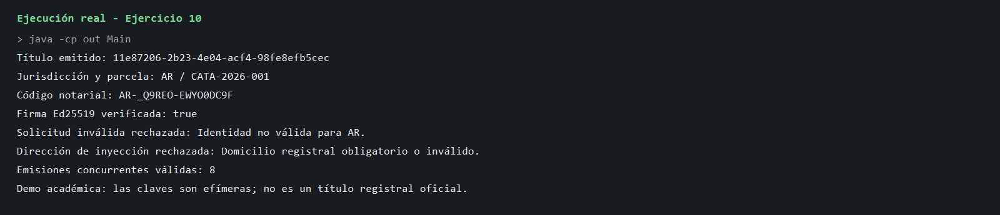

# Ejercicio 10 - Emisión de títulos de propiedad

La factoría concurrente sólo emite para jurisdicciones registradas. Cada emisor valida identidad, parcela y domicilio antes de construir el documento, genera un código de validación y firma el contenido con Ed25519; las claves privadas y verificaciones quedan encapsuladas en el emisor.

## Compilar y ejecutar

Desde esta carpeta, con JDK 17 o posterior:

```powershell
javac -encoding UTF-8 -d out src\Main.java
java -cp out Main
```

No requiere dependencias externas. La demostración usa claves efímeras generadas al iniciar el proceso y comprueba la firma y emisiones concurrentes. Es un ejercicio académico: no representa un título oficial ni sustituye normas, autoridades o infraestructura registral reales.

## Evidencia

La salida confirma la verificación criptográfica, el rechazo de datos inválidos y las emisiones concurrentes:


