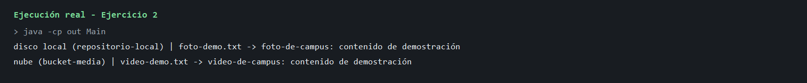

# Ejercicio 2 - Conexiones a repositorios de archivos

La interfaz `FileStorage` unifica guardar y recuperar. La implementación local escribe en `captura\repositorio-local` y valida el nombre para impedir rutas externas; la implementación cloud simula un bucket con almacenamiento en memoria, sin credenciales ni servicios de terceros. `FileService` sólo depende de `StorageCreator`.

## Compilar y ejecutar

Desde esta carpeta, con JDK 17 o posterior:

```powershell
javac -encoding UTF-8 -d out src\Main.java
java -cp out Main
```

No requiere dependencias externas. El ejemplo deja el archivo local recuperable dentro de `captura`; el conector cloud es una simulación ejecutable en memoria.

## Evidencia

La salida muestra ambos conectores guardando y recuperando contenido:


