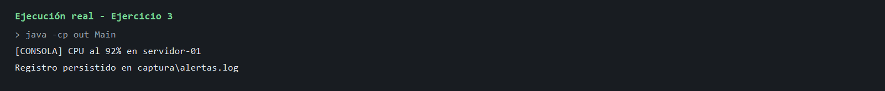

# Ejercicio 3 - Alertas por canal de texto

`AlertChannel` define un contrato común. Las factorías producen un canal de consola o un canal que agrega el mensaje a `captura\alertas.log`; `MonitoringAlerts` consume únicamente el creador base.

## Compilar y ejecutar

Desde esta carpeta, con JDK 17 o posterior:

```powershell
javac -encoding UTF-8 -d out src\Main.java
java -cp out Main
```

No requiere dependencias externas. Cada ejecución agrega una alerta al archivo de registro.

## Evidencia

La imagen recoge la salida de consola; el segundo mensaje queda persistido en el archivo indicado:


