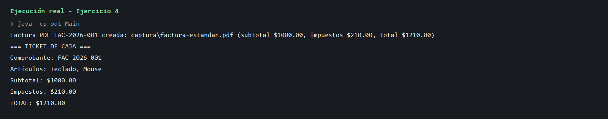

# Ejercicio 4 - Generadores de comprobantes

El creador base valida número, artículos, subtotal y tasa impositiva antes de invocar su método de fábrica. El generador PDF crea un PDF mínimo válido sin bibliotecas externas; el generador de ticket aplica su propio formato. Ambos muestran subtotal, impuesto y total calculados con `BigDecimal`.

## Compilar y ejecutar

Desde esta carpeta, con JDK 17 o posterior:

```powershell
javac -encoding UTF-8 -d out src\Main.java
java -cp out Main
```

No requiere dependencias externas. El PDF se escribe en `captura\factura-estandar.pdf`; el ticket se imprime en consola.

## Evidencia

La salida real muestra el comprobante PDF generado y el ticket con el mismo subtotal, impuesto y total:


