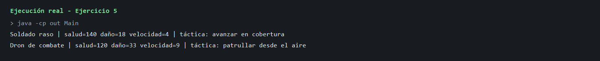

# Ejercicio 5 - Generador de enemigos

La fábrica recibe tipo y dificultad, y delega a creadores concretos de soldados y drones. Cada producto establece salud, daño, velocidad y táctica inicial; el cliente no contiene condicionales de configuración.

## Compilar y ejecutar

Desde esta carpeta, con JDK 17 o posterior:

```powershell
javac -encoding UTF-8 -d out src\Main.java
java -cp out Main
```

No requiere dependencias externas.

## Evidencia

La salida muestra dos tipos de enemigo con atributos escalados por dificultad y su táctica inicial:


