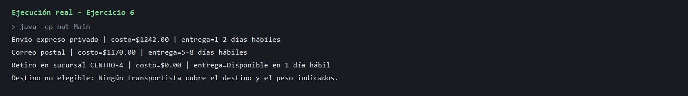

# Ejercicio 6 - Métodos de envío logístico

La fábrica prueba creadores polimórficos de retiro, envío expreso y correo postal en función de zona, distancia, peso y sucursal. Cada creador valida la cobertura, aplica su tarifa/recargo y devuelve costo y plazo; los datos no cubiertos se rechazan.

## Compilar y ejecutar

Desde esta carpeta, con JDK 17 o posterior:

```powershell
javac -encoding UTF-8 -d out src\Main.java
java -cp out Main
```

No requiere dependencias externas.

## Evidencia

La salida contiene un caso por transportista y una solicitud no cubierta que se rechaza:


