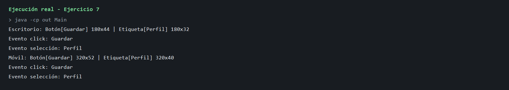

# Ejercicio 7 - Componentes gráficos minimalistas

Las factorías de escritorio y móvil crean botones y etiquetas con el mismo ancho de diseño por familia. Ambos componentes comparten el contrato de renderizado y atienden eventos de interacción.

## Compilar y ejecutar

Desde esta carpeta, con JDK 17 o posterior:

```powershell
javac -encoding UTF-8 -d out src\Main.java
java -cp out Main
```

No requiere dependencias externas.

## Evidencia

La salida muestra componentes compatibles por resolución y sus eventos:


