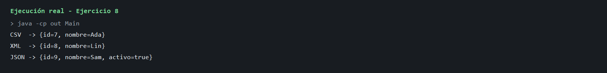

# Ejercicio 8 - Refactorización de importadores

El procesamiento consume importadores por interfaz y el registro resuelve el creador según la extensión, separando selección de lectura. Incluye CSV plano (encabezado y primera fila), XML con entidades externas desactivadas y objetos JSON planos con valores escalares; no admite estructuras JSON anidadas.

## Compilar y ejecutar

Desde esta carpeta, con JDK 17 o posterior:

```powershell
javac -encoding UTF-8 -d out src\Main.java
java -cp out Main
```

No requiere dependencias externas; XML usa el parser del JDK.

## Evidencia

La salida muestra la misma forma de resultado (`clave=valor`) para CSV, XML y JSON:


