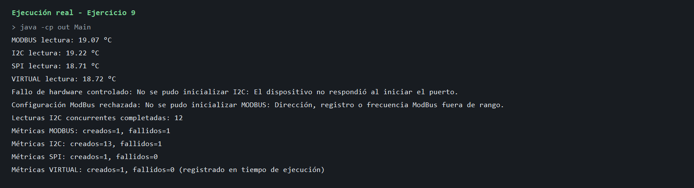

# Ejercicio 9 - Sensores ambientales IoT

Una factoría concurrente registra protocolos por nombre y permite añadir implementaciones durante la ejecución. Los creadores ModBus, I2C y SPI validan direcciones, canales y frecuencias; los conectores tienen cierre seguro, manejo de fallos y métricas concurrentes. El backend incluido simula hardware, no accede a puertos físicos.

## Compilar y ejecutar

Desde esta carpeta, con JDK 17 o posterior:

```powershell
javac -encoding UTF-8 -d out src\Main.java
java -cp out Main
```

No requiere dependencias externas. La demostración registra un protocolo virtual en tiempo de ejecución, controla fallos de inicialización y validación, y ejecuta lecturas concurrentes.

## Evidencia

La salida real incluye una lectura por protocolo, el fallo simulado y los contadores luego del trabajo concurrente:


